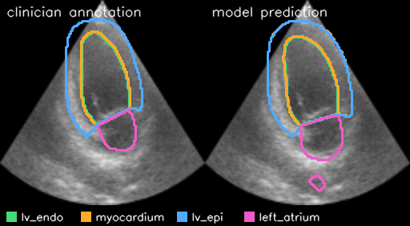

# EchoSeg-RT

Real-time, multi-label segmentation of ultrasound video in PyTorch, with patient-level evaluation, event-level metrics and an inference latency benchmark.



The model outlines four cardiac structures frame by frame on echocardiography video from the public [CAMUS](https://www.creatis.insa-lyon.fr/Challenge/camus/) dataset (500 patients, two views each, expert annotations on every frame of a half cardiac cycle).

## What it does

| Area | What is implemented |
|---|---|
| Multi-label targets | Four sigmoid outputs: `lv_endo`, `myocardium`, `lv_epi`, `left_atrium`. `lv_epi` contains the other two left-ventricle labels, so labels overlap and softmax cannot be used. |
| Class imbalance and thin targets | Per-label soft Dice plus BCE, with optional rarity-based positive weights (`train.pos_weight=auto`). The myocardium is a wall a few pixels thick. |
| Temporal context | `data.context=N` stacks the N previous frames as input channels. It is causal, so it adds no latency in a live setting. |
| Train and test separation | Splits are by patient, saved inside every checkpoint, and evaluation reads the split from the checkpoint. A test fails if a patient appears in two splits. |
| Evaluation | Per-label Dice and IoU, frame-level presence precision and recall, event-level detection and false alarms, sustained-failure events, and frame-to-frame area jitter. Results are also broken down by CAMUS image quality grade. |
| Inference optimisation | Benchmark across fp32, mixed precision, `channels_last`, `torch.compile` and batch size, with the source frame rate each supports at frame stride 2. |
| Reproducibility | One YAML config with command-line overrides, fixed seeds, resumable checkpoints, a per-epoch CSV log, and a config hash stamped on every checkpoint and report. |
| Engineering | Unit and end-to-end tests on synthetic data, GitHub Actions CI, Dockerfile, [model card](MODEL_CARD.md). |

## Results

Held-out test split: 100 patients, 200 sequences, 3,828 frames, never seen in training (350 patients) or validation (50 patients). Each model trained for 8 epochs on one Tesla T4. Full reports, training logs and the exact patient split are in [results/](results/).

Dice on the test patients:

| Model | Mean Dice | lv_endo | myocardium | lv_epi | left_atrium |
|---|---|---|---|---|---|
| U-Net ResNet34, single frame | 0.908 | 0.931 | 0.859 | 0.952 | 0.891 |
| U-Net ResNet34, 2 previous frames | 0.911 | 0.934 | 0.866 | 0.954 | 0.890 |

Temporal behaviour (jitter is mean frame-to-frame area change, lower is steadier; a sustained failure is 3 or more consecutive frames below 0.7 Dice for a label):

| Model | myocardium jitter | left_atrium jitter | sustained failures in 200 sequences |
|---|---|---|---|
| Annotation | 0.005 | 0.020 | n/a |
| Single frame | 0.016 | 0.036 | 19 |
| 2 previous frames | 0.012 | 0.030 | 16 |

What the experiment shows:

- Temporal context barely moves Dice (+0.003) but makes the output steadier: jitter falls 25% on the myocardium and 17% on the left atrium. Both models still flicker more than the annotations.
- The thin myocardium has the lowest Dice, and the left atrium accounts for most sustained failures (14 of the 19 for the single-frame model).
- Accuracy degrades only slightly with image quality: mean Dice 0.912 on Good, 0.904 on Medium and 0.900 on Poor sequences (single-frame model).
- Validation Dice plateaus after the first epoch while training loss keeps falling, so longer training would need stronger augmentation rather than more epochs.

Inference on a Tesla T4 at 256x256, single-frame model ([full table](results/unet_r34_ctx0/benchmark.md)):

| Variant | Batch | ms / frame | Frames / s |
|---|---|---|---|
| fp32 | 1 | 7.26 | 138 |
| mixed precision | 1 | 8.16 | 123 |
| mixed precision + channels_last + torch.compile | 1 | 3.29 | 304 |
| fp32 | 8 | 4.49 | 223 |
| mixed precision + channels_last | 8 | 1.98 | 506 |
| mixed precision + channels_last + torch.compile | 8 | 1.37 | 730 |

At batch size 1, which is what a live feed uses, mixed precision alone gives no speed-up; the gain comes from `torch.compile` (2.2x faster than fp32). Mixed precision pays off once frames are batched (2.3x at batch 8), at the cost of buffering delay. The benchmark times the network forward pass only, without video decoding or drawing.

## Metric definitions

- **Frame-level presence**: a label is present in a frame when its mask covers at least `eval.min_area` pixels. Precision and recall are computed over frames.
- **Presence event**: one continuous run of frames in which a label is present. A ground-truth event is detected if the model predicts the label in any of its frames. A false alarm is a predicted run that overlaps no ground-truth event, reported per minute of video.
- **Sustained failure**: at least `eval.fail_min_frames` consecutive frames where a label's Dice is below `eval.fail_dice`. A single bad frame flickers past; a sustained failure is what a clinician would notice.
- **Area jitter**: mean absolute frame-to-frame change in mask area, divided by mean area.

## Run it

```bash
pip install -r requirements.txt
python scripts/download_camus.py --out data/raw            # about 3.5 GB; add --n 150 for a subset
python -m echoseg.data preprocess --raw data/raw --out data/processed

python -m echoseg.train                                                   # single frame
python -m echoseg.train --set data.context=2 run_name=unet_r34_ctx2      # temporal context

python -m echoseg.evaluate --checkpoint runs/unet_r34_ctx0/best.pt
python -m echoseg.benchmark --checkpoint runs/unet_r34_ctx0/best.pt
python -m echoseg.demo --checkpoint runs/unet_r34_ctx0/best.pt --out assets/demo.gif
pytest -q
```

[notebooks/colab_run.ipynb](notebooks/colab_run.ipynb) and [notebooks/kaggle_run.ipynb](notebooks/kaggle_run.ipynb) run all of the above on a free Colab or Kaggle GPU.

Other architectures come from the config, for example `--set model.arch=fpn model.encoder=efficientnet-b0`.

With Docker:

```bash
docker build -t echoseg-rt .
docker run --gpus all -v $PWD/data:/app/data -v $PWD/runs:/app/runs echoseg-rt echoseg.train
```

## Limitations

- CAMUS is cardiac ultrasound from one hospital. Nothing here has been validated on other anatomy, probes or sites.
- All four structures are in view in almost every CAMUS frame, so presence-event recall is close to 1 by construction. The event logic is exercised by unit tests on synthetic sequences where a structure leaves the view; a dataset with intermittent findings is needed for it to be informative.
- Frames are resized to a square, which changes the aspect ratio.
- Sequences cover half a cardiac cycle (about 20 frames), so temporal metrics describe short clips only.
- This is a research project, not a medical device.

## Data citation

S. Leclerc et al., "Deep Learning for Segmentation using an Open Large-Scale Dataset in 2D Echocardiography", IEEE Transactions on Medical Imaging, 2019.
